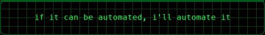

<!--
88x31 badges: https://cyber.dabamos.de/88x31/ (copy ok; don't hotlink).
Pixel GIFs: GifCities / Internet Archive GeoCities.
See media/badges/SOURCES.txt and media/gifs/SOURCES.txt — none AI-generated.
-->

# hey, i'm raj

**software engineer.** i make AI write a lot of the code, then i break it until it's real.

also: [chatarmin](https://chatarmin.com) in vienna — migrations, technical SEO, making the platform actually fast.

[site](https://rajgupta.site) · [x](https://x.com/_rajtwt) · [linkedin](https://www.linkedin.com/in/raajguptaa/) · [mail](mailto:raj96yt@gmail.com)

## right now

cooking:

- automating a youtube channel end-to-end — video gen included
- shipping ~2 ios apps a month
- automating job-search leads so outreach isn't a full-time job
- learning marketing

if it can be scripted, i'm scripting it.

  

## projects

- **[CFD](https://github.com/Rajgupta36/CFD)** — rust trading engine. 50k+ evt/s. built it to feel what realtime costs.
- **[Safka](https://github.com/Rajgupta36/Safka)** — kafka, but small, and i wrote the broker. rust/tokio.
- **[Mux-RAG](https://github.com/Rajgupta36/mux-rag)** — multimodal rag over pdfs. text, tables, images → answer.

## open source

- **[OWASP/Nest](https://github.com/OWASP/Nest)** — contribution hub
- **[AOSSIE-Org/PictoPy](https://github.com/AOSSIE-Org/PictoPy)** — privacy-first photo manager. setup, docker, docs, filtering
- **[code100x/cms](https://github.com/code100x/cms)** — video autoplay on hover

## work that paid rent

**gsoc '25 / [owasp nest](https://nest.owasp.org)** — contribution hub end-to-end: 50+ merges, 68+ playwright tests, led the react → next rewrite. funded work that shipped.

**chatarmin** — owned the ugly stuff: strapi→sanity (1k+ docs), help center ~1200ms→~80ms, ~500k-ticket migrations, SEO that wasn't "add keywords" ([pow](https://rajgupta.site/pow)).

---

  
  &nbsp;
  
  

