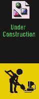

<!--
Classic Web 1.0 badges are REAL downloads (not AI-generated):
- 88x31 buttons from https://cyber.dabamos.de/88x31/
  ("Feel free to copy buttons to your website, but avoid hot-linking")
- under-construction / fire bars from http://textfiles.com/underconstruction/
  (Archive Team GeoCities rescue)
See media/badges/SOURCES.txt
-->

  
  
  
  

  

# hey, i'm raj

software engineer. AI writes a lot of the code — i break it until it's real.

ex [chatarmin](https://chatarmin.com) (vienna) · [gsoc '25 @ owasp nest](https://summerofcode.withgoogle.com/programs/2025/projects/pZB3XGpa)

[site](https://rajgupta.site) · [x](https://x.com/_rajtwt) · [linkedin](https://www.linkedin.com/in/raajguptaa/) · [mail](mailto:raj96yt@gmail.com)

---

## right now

- youtube channel automation (+ video gen)
- ~2 ios apps / month
- job-lead outreach scripts

  

## projects

- **[CFD](https://github.com/Rajgupta36/CFD)** — rust trading engine · 50k+ evt/s
- **[Safka](https://github.com/Rajgupta36/Safka)** — kafka-ish broker from scratch (rust/tokio)
- **[Mux-RAG](https://github.com/Rajgupta36/mux-rag)** — multimodal rag over pdfs

## receipts

chatarmin: **1k+** docs migrated · help center **~1.2s → ~80ms** · **~500k** tickets · crawl budget **70%** fixed  
→ [pow](https://rajgupta.site/pow)

owasp nest: **50+** merged prs · **68+** playwright tests · react→next in ~3 weeks

---

  
  
  
  
  
  
  
  
  
  
  
  
  
  
  
  

  

  this page is under construction forever · please come back later

