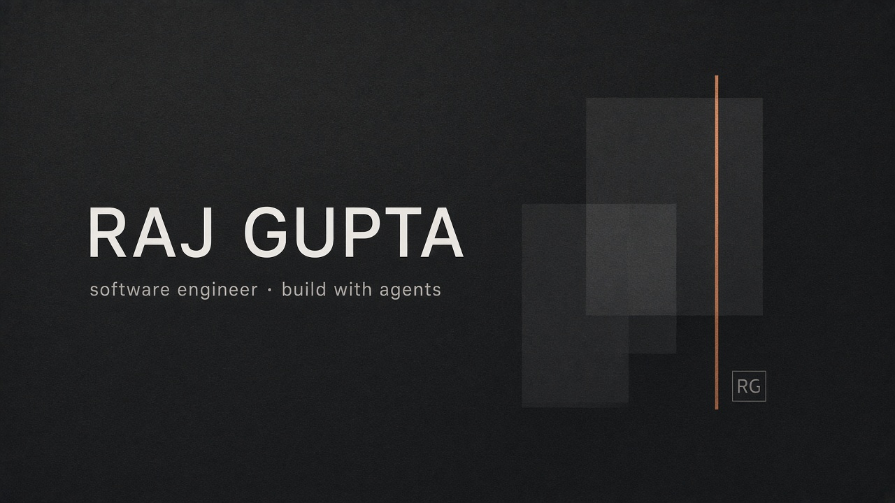
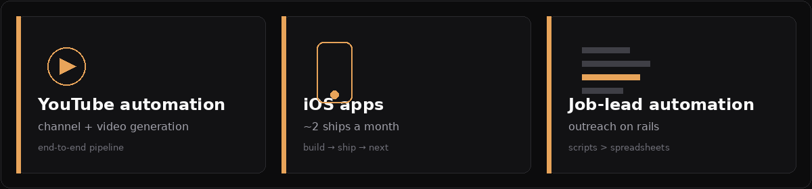
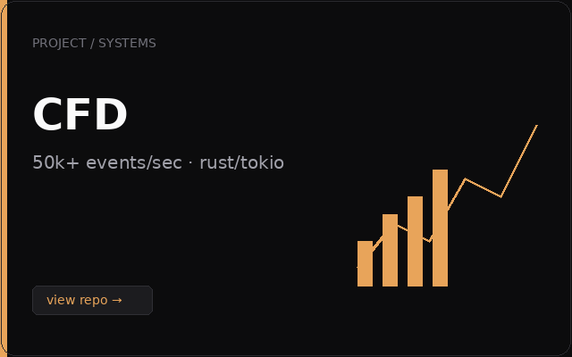
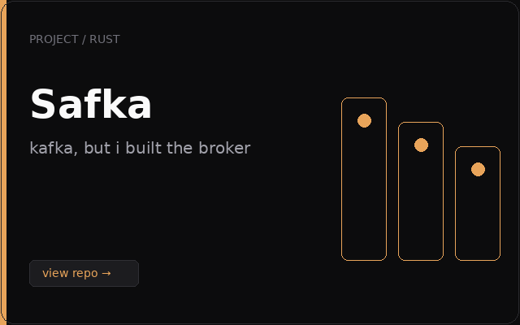
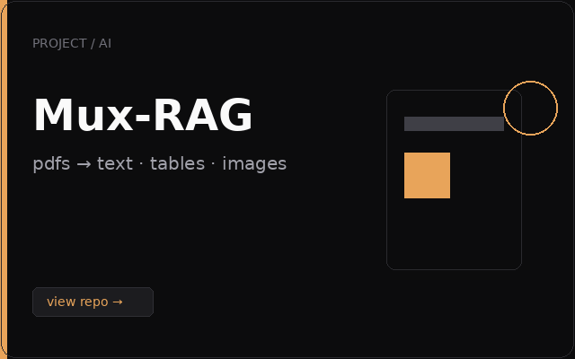
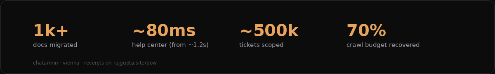

<!-- Profile README for github.com/Rajgupta36 — media/ ships with this file so ./media paths resolve. -->

  

# hey, i'm raj

software engineer. i make AI write a lot of the code, then i break it until it's real.

spent the last stretch at [chatarmin](https://chatarmin.com) in vienna — migrations, technical SEO, making the platform actually fast. before that: [gsoc '25 @ owasp nest](https://summerofcode.withgoogle.com/programs/2025/projects/pZB3XGpa).

[rajgupta.site](https://rajgupta.site) · [x](https://x.com/_rajtwt) · [linkedin](https://www.linkedin.com/in/raajguptaa/) · [mail](mailto:raj96yt@gmail.com)

---

## right now

  

<!-- optional richer hero: ./media/right-now-hero.jpg -->

cooking in public:

- **automating a youtube channel** end-to-end — video generation included
- **shipping ~2 ios apps a month**
- **automating job-search leads** so outreach isn't a full-time job

if it can be scripted, i'm scripting it. if AI can draft it, i let it — then i check the work.

---

## projects

the ones that matter:

  
  
  

### [CFD](https://github.com/Rajgupta36/CFD)
trading execution engine in rust/tokio. was pushing **50k+ events/sec**, redis streams + timescaledb, websocket updates under 100ms. built it to feel what "realtime" actually costs.

### [Safka](https://github.com/Rajgupta36/Safka)
kafka, but small, and i wrote the broker myself. rust + tokio — partitions, consumer groups, offsets, acks.

### [Mux-RAG](https://github.com/Rajgupta36/mux-rag)
multimodal rag over pdfs — text, tables, images. pull top 10 chunks, rerank to 3, answer. python / langchain / openai.

more random builds: [rajgupta.site/projects](https://rajgupta.site/projects)

---

## work that paid rent

  

at chatarmin i owned the ugly stuff:

- strapi → sanity (**1k+ docs**, 100+ schemas, zero drama if i did it right)
- help center **~1200ms → ~80ms**
- support migrations up to **~500k tickets** (helpscout / zendesk / gorgias / …)
- seo engineering that wasn't "add keywords" — crawl budget (googlebot was wasting **70%** of **1.2M+** hits on a widget host), sitemaps **150 → 743** urls, ssr schema, lcp work

long version with receipts: [rajgupta.site/pow](https://rajgupta.site/pow)

---

## open source

gsoc 2025 on [owasp nest](https://nest.owasp.org) — mentorship / contribution hub.

react → next rebuild in ~3 weeks. **50+** merged prs. **68+** playwright tests. django models + slack automation.

[prs](https://github.com/OWASP/Nest/pulls?q=is%3Apr+author%3ARajgupta36+is%3Amerged)

---

## stack

typescript, rust, python, sql · next/react/node · postgres/redis · tokio · langchain · docker/aws/cloudflare

i don't collect badges. i ship.

---

wanna talk? **raj96yt@gmail.com**
